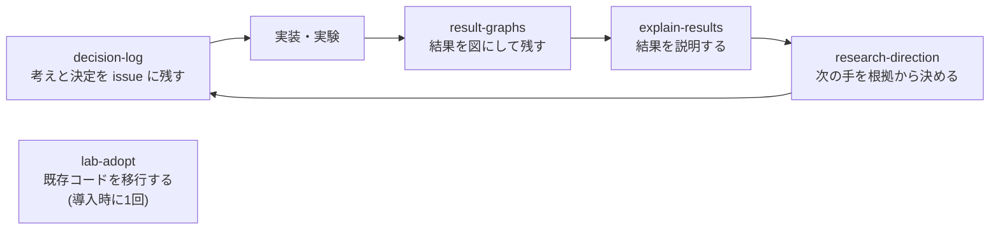
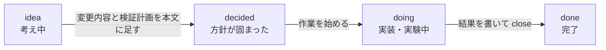

# mksmkss-lab-kit

研究用の共通道具と Claude Code の Skill を、**既存のプロジェクトを壊さずに**入れるキット。

- 決定の経緯を GitHub の issue に残す
- データを保存するとき、元データ・作成者・処理内容を `*_metadata.yaml` に残す
- 既存の Jupyter ノートブックを marimo に変換する
- 日本語が化けない plotly、データの系譜図、MPS / CUDA / CPU の自動選択

## AI に頼んで導入する

コマンドを覚える必要はない。次のどちらかで、Claude Code に頼む。Claude は、変更を実行する前に内容を見せて、承認を待つ。

**A. このリポジトリを clone して頼む**

```bash
git clone https://github.com/mksmkss/mksmkss-lab-kit
cd mksmkss-lab-kit
claude
```

```text
~/work/my-project にこのキットを導入して。
```

このリポジトリの `CLAUDE.md` に導入の手順が書いてあるので、Claude はそれに従う。

**B. 導入したいプロジェクトで頼む**

```bash
cd ~/work/my-project
claude
```

```text
https://github.com/mksmkss/mksmkss-lab-kit の README を読んで、このプロジェクトに導入して。
変更内容は先に見せて、私が OK してから進めて。
既存の Jupyter ノートブックは、marimo に変換したい。
```

導入が終わったら、そのプロジェクトで Claude を開き直す(Skill は次のセッションから読み込まれる)。続けて、こう頼む。

```text
lab-adopt で、このプロジェクトを lab-kit のやり方にそろえて。
```

> このリポジトリが非公開の間は、招待された人だけが取得できる。招待されたら、`gh auth login` と `gh auth setup-git` を一度実行しておく。

## Skill とは

Claude Code に「この種類の作業は、こうやって進める」と教える手順書。`.claude/skills/<名前>/SKILL.md` というファイルで、プロジェクトに置く。作業の内容に合うと、Claude が自動で読み込む。`/名前` で呼ぶこともできる。

自分の研究のやり方(結果の説明の型、記録の残し方など)を Skill にしておくと、毎回説明しなくても、Claude が同じやり方で進めてくれる。

## 入っているもの

| 種類 | 名前 | 内容 |
|---|---|---|
| Skill | `decision-log` | 1テーマ = 1 issue。本文に現状、コメントに決定の記録(D1, D2…)。先生との相談の記録にも使う |
| Skill | `explain-results` | 結果の説明の型(何をしたくて → 計算 → 値 → 意味) |
| Skill | `result-graphs` | 結果を plotly の図にして残す |
| Skill | `research-direction` | 次に何を試すかを、数値の根拠から決める進め方。目的と比較の基準は、各人の `docs/research-direction.md` に書く(無ければ質問して作る) |
| Skill | `lab-adopt` | 既存コードを調べ、移行案を出し、承認された分だけ書き換える |
| Python | `lab_kit` | メタ情報つき保存・読込・系譜、`project_root` / `data_path` / `results_path`、`get_device`、`lab_kit.viz`(日本語フォント、PNG 保存) |
| コマンド | `lab-kit` | `init` `update` `labels` `doctor` `to-marimo` `lineage` |
| 雛形 | — | `CLAUDE.md` と `.gitignore` のブロック、`.env.example`、marimo テンプレート、`data/` `results/` |

Skill どうしの関係:



`decision-log` の issue は、ラベルで段階を表す。



決定が出るたびに、コメントに D1, D2… を追記し、本文を最新にする。

## marimo

- **既存の ipynb を変換する**: `uv run lab-kit to-marimo`。プロジェクト内の `.ipynb` を `.py` に一括変換し、変換後に `marimo check` をかける。元の `.ipynb` は残し、同名の `.py` があれば飛ばす。`--dry-run` で予定だけ見られる。
- **marimo 公式の Skill を入れる**(node が必要)。`jupyter-to-marimo`(変換)と `marimo-notebook`(正しい書き方)を入れる。
  ```bash
  npx skills add marimo-team/skills --agent claude-code --skill jupyter-to-marimo --skill marimo-notebook
  ```
  公式の Skill は、他にもある(論文の実装、anywidget など)。[marimo-team/skills](https://github.com/marimo-team/skills) を見て、必要なら足す。
- 導入時に新しい `.ipynb` を作らないよう、`CLAUDE.md` のブロックにも書いてある。

## 自分で導入する

プロジェクトのルートで実行する。新規でも既存でも同じ。

```bash
uv init --bare                                              # pyproject.toml が無いときだけ
uv add git+https://github.com/mksmkss/mksmkss-lab-kit      # パッケージを入れる
uv run lab-kit init --dry-run                               # 何が入るか確認(何も変更しない)
uv run lab-kit init                                         # 入れる
uv run lab-kit doctor                                       # 環境を確認
uv run lab-kit labels --kinds default                       # GitHub のラベルを作る(gh のログインが必要)
```

前提は、Python 3.10 以上、[uv](https://docs.astral.sh/uv/)、git。`decision-log` を使うなら、[gh](https://cli.github.com/) にログインしておく(`gh auth login`)。

プロジェクトに `uv add` したくなければ、`uvx --from git+https://github.com/mksmkss/mksmkss-lab-kit lab-kit init` で、`init` だけ実行できる(Python の `lab_kit` は使えない)。

### 既存のプロジェクトで、何が起きるか

`init` は何度実行しても同じ結果になる。

| 対象 | 無いとき | 既にあるとき |
|---|---|---|
| Skill、`.env.example`、`notebooks/_template.py` | 作る | **上書きしない。** 内容が違えば、横に `*.lab-kit.new` を置いて差分を見せる |
| `CLAUDE.md`、`.gitignore` | 管理ブロックだけで作る | **自分の記述は残し**、末尾に管理ブロックを追記する |
| `data/` `results/` | `.gitkeep` を置く | 中身には触らない |
| コード、データ、`pyproject.toml` | — | 触らない(`uv add` が依存を1行足すだけ) |

### 更新

```bash
uv lock --upgrade-package lab-kit && uv sync
uv run lab-kit update --dry-run     # 何が変わるか確認
uv run lab-kit update               # 手元で編集していないファイルと、管理ブロックだけ最新にする
```

手元で編集した Skill は上書きされない。`*.lab-kit.new` を見て、必要な部分だけ取り込む。

## 導入前後の変化

| 項目 | 導入前 | 導入後 |
|---|---|---|
| 決定の記録 | 頭の中、チャット、メモに散らばる | テーマごとの issue に、背景・根拠つきで時系列に残る |
| 現状の把握 | 過去の会話を読み返す | issue の本文を読む |
| 先生との相談 | 口頭、または自分のメモ | 相談ごとの issue に、指摘・決定・TODO が残る |
| ノートブック | `.ipynb`(差分が読みにくく、実行順で結果が変わる) | marimo の `.py`(差分が読め、順序に依存しない) |
| データの来歴 | 「このファイルはどこから?」が分からなくなる | `*_metadata.yaml` に残り、系譜図にできる |
| パス | `/Users/...` の直書き、`sys.path.append` | `project_root()` `data_path()`。別の PC でも動く |
| 図の日本語 | 図ごとにフォント指定がバラバラ | `lab_kit.viz` に1か所 |
| データの置き場 | `data/` と `results/` に図が二重に置かれる | データは `data/`、図・表は `results/<実験名>/` |

## 使い方

### Skill(日本語で頼む)

| やりたいこと | 頼み方の例 |
|---|---|
| 考え中のことを残す | 「この実験の論点を整理して、issue に残して」 |
| 決まったことを残す | 「いま決めた α の設定を、理由つきで記録して」 |
| 実装に入る | 「方針が固まったので、AsIs / ToBe をまとめて、実装段階にして」 |
| 作業を始める・終える | 「この issue を作業中にして」「完了にして閉じて」 |
| 先生との相談 | 「明日の相談の issue を作って。論点は…」「相談の結果を記録して。先生の指摘は…」 |
| 結果を説明してもらう | 「この値は何?」 |
| 結果を図にして残す | 「この結果をグラフにして残して」 |
| 次に何を試すか決める | 「research-direction で、次に試すことを決めて」 |
| 既存コードをそろえる | 「lab-adopt で、このプロジェクトを移行して」 |

投稿の前に、Claude は下書きを見せる。内容を確認して「OK」と答えると、GitHub に投稿される。「残して」「記録して」と頼んだ決定の記録だけは、そのまま投稿し、あとで内容を報告する。

### Python

```python
import pandas as pd
from lab_kit import data_path, results_path, save_data_with_metadata, get_device
from lab_kit.viz import save_figure

raw = data_path("raw", "input.csv")          # <プロジェクトルート>/data/raw/input.csv
df = pd.read_csv(raw)

save_data_with_metadata(
    df,
    data_path("interim", "cleaned.csv"),
    created_by="prep.py",                    # 必須。作ったスクリプト名
    source_info=raw,                         # 元データ(複数ならリスト)
    processing_steps=["欠損値の除去"],
    config={"drop_na": True},
    format="csv",                            # csv / parquet / npy / pt / pickle / sqlite
)
# → cleaned.csv と cleaned_metadata.yaml ができる

save_figure(fig, results_path("exp1", "figures", "alpha_sweep"))   # 日本語対応の PNG
device = get_device()                        # "mps" > "cuda" > "cpu"
```

- プロジェクトルートは、環境変数 `MAIN_PATH`、`.env` の `MAIN_PATH`、`.git` か `pyproject.toml` のあるフォルダの順に決まる。普通は何も設定しなくてよい。
- PNG の保存には、`kaleido` と Google Chrome が必要(`uv add kaleido`、Chrome は `uv run plotly_get_chrome`)。
- 追加の依存: `[ml]`(scikit-learn のメタ情報)、`[torch]`、`[marimo]`、`[viz]`(kaleido)。例: `uv add "lab-kit[marimo]"`。

### コマンド

| コマンド | 内容 |
|---|---|
| `lab-kit init [--dry-run] [--agents] [--dir DIR]` | Skill、ブロック、雛形を入れる。`--agents` は `.agents/skills/` にもリンクを作る |
| `lab-kit update [--dry-run]` | 入れたものを最新にする |
| `lab-kit labels [--kinds default\|名前,名前] [--repo OWNER/REPO] [--dry-run]` | `decision-log` 用のラベルを作る(無いものだけ) |
| `lab-kit doctor` | Python、git、uv、gh、公開範囲、marimo 公式 Skill などを確認する |
| `lab-kit to-marimo [PATH ...] [--dry-run] [--no-check]` | `.ipynb` を marimo に変換する |
| `lab-kit lineage [--dir DIR] [--out DIR] [--quiet]` | `*_metadata.yaml` から系譜図(Mermaid)を `docs/data_lineage/` に出す |

## issue の使い方(GitHub が初めての人向け)

**issue** は、話題ごとに1ページ作れる記録用のページ。上に**本文**、下に時系列の**コメント**が並ぶ。ここでは、1つの研究テーマを1つの issue にする。

| 場所 | 内容 | 読み方 |
|---|---|---|
| 本文 | いまの結論(現状、方針、AsIs / ToBe、検証計画、決定の一覧、未解決の論点) | まず本文だけ読めば、今どうなっているか分かる。決定が出るたびに更新される |
| コメント | 決定の記録(D1, D2…)、経過、失敗 | 上から読めば経緯が分かる。書き換えず、追記だけする |
| ラベル | 段階(`idea` `decided` `doing` `done`)、種類 | 一覧で段階が分かる |

ブラウザでリポジトリを開き、上のタブ **Issues** を押すと見られる。検索欄に `label:doing` と入れると、絞り込める。閉じたものは「Closed」にある。

決定の記録は、次の項目でできている。迷ったら「決定」と「背景」だけ読めばよい。

| 項目 | 内容 |
|---|---|
| 決定 | 何をどうすると決めたか |
| 決定者 | 自分か、先生との相談か、共同研究者か |
| 背景 | なぜ必要になったか |
| 根拠 | データ・数値・ファイルのパス |
| 検討した代替案 | 他に何を考え、なぜ採らなかったか |
| 影響・残る問題 | できなくなること、未確認のこと |
| 過去の決定との関係 | 以前の決定を置き換えるか、前提にするか |

守ること:

1. 本文は最新の結論、コメントは時系列の記録。方針が変わったら、本文を直し、理由を新しいコメントに書く。
2. 決めたら、すぐ残す。まとめて後で書かない。
3. 試して使えなかったことも残す。
4. 確認していないことは「未確認」と書く。事実と推測を分ける。
5. 元データの内容や個人情報は書かない。
6. コミットメッセージに `Refs #12` と書くと、issue #12 とコードが結びつく。

**先生との相談**は、テーマとは別に、`meeting` ラベルの issue にする。相談の前に「相談したいこと」を書き、相談の後に、先生の指摘・自分の理解・決まったこと・TODO を書く。先生の発言と自分の解釈は分ける。方針に関わる決定は、テーマの issue にも決定の記録として書く。公開リポジトリでは作らない(Skill が止める)。

## 推奨するフォルダ構成

`init` は `data/` と `results/` の雛形を作るだけで、他のフォルダは動かさない。移したいときは `lab-adopt` に頼む(移動案を表で見せ、承認された分だけ動かす)。

```text
.
├── pyproject.toml / uv.lock / .python-version
├── CLAUDE.md
├── .claude/skills/         # Skill
├── .lab-kit/manifest.json  # init が配ったファイルの記録(コミットしておく)
├── src/<project>/          # 再利用するコード
├── notebooks/              # marimo の .py だけ
├── scripts/                # 重い処理(CLI で回す)
├── data/{raw,interim,processed}/   # 本体は gitignore。*_metadata.yaml だけ追跡
├── results/<実験名>/       # 図・表。コミットするのはここ
└── docs/                   # 系譜図など、自動生成物
```

## 困ったとき

| 症状 | 対処 |
|---|---|
| `uv add git+https://...` が認証で失敗する | 招待されていない、または `gh auth setup-git` をしていない |
| `gh` が見つからない、ログインしていない | `lab-kit doctor` の案内に従う。ログインは `gh auth login` |
| `lab-kit labels` が失敗する | `gh auth status` を確認する。リポジトリの外なら `--repo OWNER/REPO` を付ける |
| `*.lab-kit.new` ができた | 既に別の内容のファイルがあったため、上書きしなかった。差分を見て、取り込むか削除する |
| PNG が保存できない | `kaleido` と Chrome が必要(`uv add kaleido`、`uv run plotly_get_chrome`) |
| 投稿されない | Claude が下書きを出して待っている。「OK」と答える |
| 間違えて投稿した | コメントは GitHub 上で編集・削除できる。ただし履歴に残り得る |

## 開発

```bash
uv sync
uv run ruff check src tests
uv run pytest -q
```

配布物は `src/lab_kit/scaffold/` にある。`init` と `update` は、そこから配る。

## ライセンス

MIT
